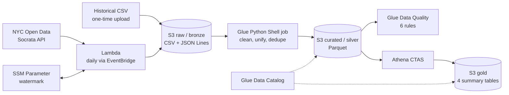

# NYC 311 Cloud ETL Pipeline on AWS

A serverless data pipeline that ingests **6.3 million+ NYC 311 service-request records** from two differently-structured sources, cleans and unifies them into a single queryable table, validates it with automated data-quality checks, and publishes pre-aggregated summary tables. Everything is defined as code (CloudFormation) and runs at roughly **$0.20/month**.

Built as a self-directed learning project to move from PostgreSQL-style ETL to cloud-native data engineering.

## Architecture



## Data layers (medallion architecture)

| Layer | What it holds | Where |
|---|---|---|
| **Bronze (raw)** | Data exactly as received: a historical CSV export plus JSON Lines from the live API. Untouched, so any later cleaning can be redone. | `raw/311/` |
| **Silver (curated)** | One cleaned, deduplicated, correctly-typed table (6,366,286 rows, 45 columns) unified from three sources with different schemas. | `curated/311/` |
| **Gold** | Four small pre-aggregated tables built with SQL (`CREATE TABLE AS SELECT`) for fast answers. | `gold/311/` |

## AWS services used

| Service | Role in the project |
|---|---|
| **S3** | Storage for every layer |
| **Lambda** | Daily incremental pull from the Socrata API |
| **EventBridge** | Scheduler that triggers the Lambda |
| **SSM Parameter Store** | Stores the incremental "watermark" (last record fetched) |
| **IAM** | Least-privilege roles scoped to specific S3 prefixes |
| **CloudWatch Logs** | Run logs, used to diagnose failures |
| **CloudFormation** | All infrastructure as code (two stacks) |
| **Glue** | Data Catalog, crawlers, the Python Shell transform job, and Data Quality |
| **Athena** | Serverless SQL over S3, including the gold-layer CTAS queries |

## Results

- **6,366,286** curated rows (Jan 2025 - Sep 2026), deduplicated across sources.
- **Glue Data Quality score: 1.0**, all 6 rules passing.
- Gold tables reconcile exactly with silver (every count-based table sums to 6,366,286).

Sample answers straight from the gold tables:

| Borough | Complaints |
|---|---|
| Brooklyn | 1,919,221 |
| Queens | 1,558,389 |
| Bronx | 1,385,663 |
| Manhattan | 1,245,539 |
| Staten Island | 251,936 |

Top complaint types in January 2026: heat/hot water (79,928), illegal parking (48,717), residential noise (28,739). NYPD closes complaints in ~2.8 hours on average; building-inspection complaints take ~870.

## Engineering challenges and what they taught me

Real problems hit and fixed during the build; the full reasoning for each is in [`Docs/decisionlog.md`](Docs/decisionlog.md):

- **Lambda out-of-memory crash** during a 16-month backlog catch-up: parsed JSON uses far more memory than its file size. Fixed by bounding work per invocation (50,000 records) and measuring real memory use.
- **Missing field in the live API**: the planned `updated_date` watermark column doesn't exist. Found by testing the real API instead of assuming; switched to `created_date` and documented the narrower semantics.
- **Glue job killed by OOM (exit 137)**: first transform loaded ~6M records into memory. Redesigned as a streaming, chunk-at-a-time job with a lightweight key set for cross-source deduplication.
- **Parquet schema inconsistency**: independently-written Parquet files had inconsistent column encodings, which Athena tolerated but Glue Data Quality's Spark engine rejected. Fixed with one explicit Arrow schema enforced on every write.
- **Silent source drift**: two exports of the "same" date range disagreed by ~44,000 rows, so deduplication logic is required even for historical data.

## Repository layout

```
infra/
  template.yaml            Phase 1: S3, Lambda, EventBridge, IAM, SSM
  phase2_transform.yaml    Phase 2: Glue Catalog, crawlers, transform job, Data Quality, Athena
src/
  incremental_lambda/      Lambda that pulls new records from the API
  glue_transform/          Glue job: clean, unify, dedupe, write Parquet
  gold/                    One SQL file per gold table
scripts/
  backfill_historical.py   One-time upload of the historical CSV
  build_gold.py            Rebuilds the gold tables
Docs/                      Architecture, decision log, runbook, data health report
```

## Running it

You need an AWS account, the AWS CLI, and Python 3.12+. Data is **not** included in this repository: the historical CSV is a public NYC Open Data export (dataset `erm2-nwe9`), and the incremental feed is pulled live from the API.

Full step-by-step instructions are in [`Docs/Runbook.md`](Docs/Runbook.md). In short: deploy `infra/template.yaml`, upload the historical CSV, deploy `infra/phase2_transform.yaml`, run the Glue job, then `python scripts/build_gold.py <bucket-name>`.

## Documentation

- [`Docs/Architecture.md`](Docs/Architecture.md): technical design for all three phases
- [`Docs/decisionlog.md`](Docs/decisionlog.md): every decision, what was rejected, and why
- [`Docs/DataHealthReport.md`](Docs/DataHealthReport.md): measured data-quality findings on the source data

## Cost

About $0.20/month (S3 storage only). The daily ingestion schedule is deliberately disabled to keep costs near zero; nothing else runs unless triggered.
